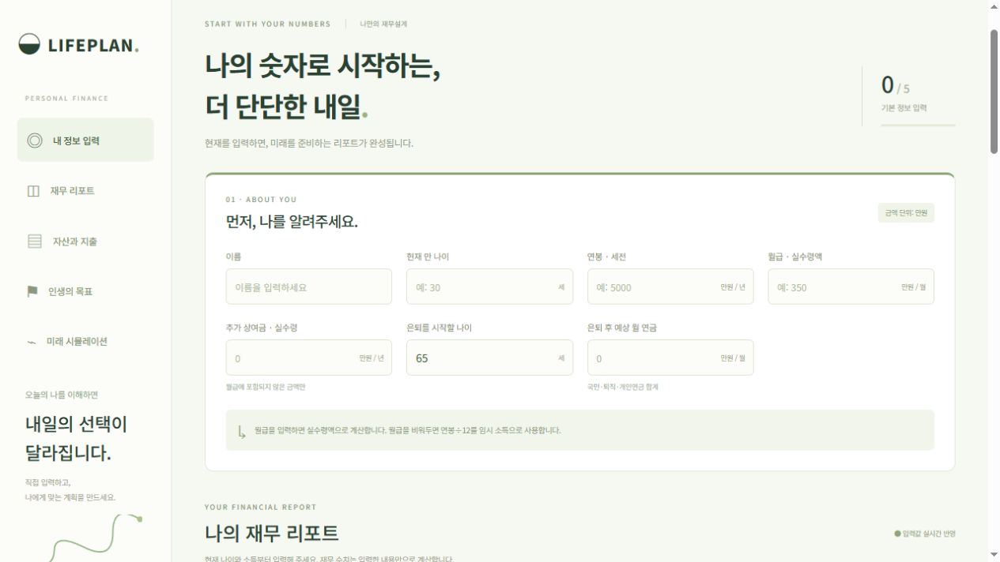

# LIFEPLAN · 나의 재무 리포트

**나이, 소득, 자산과 지출을 입력하고, 지금의 재무 상태와 은퇴 후 자산 흐름을 한 화면에서 확인하세요.**

[실행 파일 받기](LIFEPLAN.html) · [기능 살펴보기](#주요-기능) · [다운로드하고 열기](#다운로드하고-열기)



## 다운로드하고 열기

**`LIFEPLAN.html` 파일 하나면 됩니다.** 프로그램 설치나 터미널 없이 Chrome, Edge 같은 브라우저에서 사용할 수 있습니다.

1. [**LIFEPLAN.html**](LIFEPLAN.html)을 누르고, 파일 페이지 오른쪽 위의 **Download raw file**(↓) 버튼을 누릅니다.
2. 컴퓨터의 **다운로드** 폴더에서 **`LIFEPLAN.html`**을 더블클릭합니다.
3. 브라우저에 **LIFEPLAN** 화면이 열리면 이름, 나이, 월급을 입력하고 자산·부채와 지출을 추가합니다.

> 파일이 텍스트 편집기로 열리면 파일을 우클릭하고 **연결 프로그램 → Chrome 또는 Edge**를 선택하세요. 내려받은 파일 이름이 `.html`로 끝나는지 확인하세요.

전체 파일을 받고 싶다면 저장소 첫 화면에서 **Code → Download ZIP**을 누르세요. ZIP 파일의 압축을 푼 뒤, 나온 폴더 안에서 **`LIFEPLAN.html`**을 더블클릭하면 같은 화면이 열립니다.

## 주요 기능

| 메뉴 | 할 수 있는 일 |
| --- | --- |
| **내 정보 입력** | 나이, 세전 연봉, 월 실수령액, 상여금, 은퇴 나이와 예상 연금을 입력합니다. |
| **재무 리포트** | 순자산, 월 저축 여력, 은퇴 시점 금융자산, 은퇴 후 자산 부족 시점을 확인합니다. |
| **자산과 지출** | 예금·투자·부동산·대출과 반복 지출을 추가하고, 수정하거나 삭제합니다. |
| **인생의 목표** | 주택 마련이나 여행 등 목표의 금액과 시기를 정하고, 필요한 월 저축액을 계산합니다. |
| **미래 시뮬레이션** | 저축액, 지출, 은퇴 시점, 투자수익률을 바꿔 100세까지의 자산 흐름을 비교합니다. |

**처음이라면** 실수령 월급과 매달 나가는 생활비부터 입력해 보세요. 둘을 입력하면 매달 남는 금액을 볼 수 있습니다. 금액 입력 단위는 **만원**입니다. 예를 들어 월급 350만원은 `350`을 입력합니다.

## 저장과 백업

입력한 정보는 **현재 브라우저**에 저장됩니다. 다른 브라우저나 컴퓨터에서 이어서 사용하려면 상단의 **데이터 백업**으로 JSON 파일을 내려받고, 새 환경에서 **백업 불러오기**를 누르세요. 브라우저가 로컬 파일 저장을 제한하는 경우에도 JSON 백업으로 입력값을 보관할 수 있습니다.

## 계산 기준

- 실수령 월급을 입력하면 월급 기준으로 계산합니다. 세전 연봉을 중복 합산하지 않습니다.
- 순자산은 전체 자산에서 부채를 뺀 금액입니다. 미래 시뮬레이션은 금융자산에서 부채를 뺀 금액을 출발점으로 사용합니다.
- 미래 금액은 입력한 소득·지출·목표와 수익률·물가 가정에 따라 달라집니다. 수익률은 화면에서 수정할 수 있습니다.

<details>
<summary>소스 코드 실행 및 테스트</summary>

Node.js 20 이상이 필요합니다. 프로젝트 폴더에서 다음 명령을 실행한 뒤 브라우저에서 [http://127.0.0.1:4173](http://127.0.0.1:4173)을 여세요.

```sh
npm ci
npm test
npm run build
npm run dev
```

| 경로 | 내용 |
| --- | --- |
| `src/App.jsx`, `src/components/` | 입력 화면과 리포트 |
| `src/styles.css` | 화면 및 인쇄 스타일 |
| `src/domain/finance.js` | 재무 계산 |
| `src/data/repository.js` | 입력 검증, 항목 관리, 브라우저 저장 |
| `tests/` | 계산 및 저장 테스트 |
| `scripts/` | 빌드와 로컬 실행 |

`npm run build`는 `dist/재무리포트.html`도 생성합니다. 저장소 루트의 `LIFEPLAN.html`은 설치 없이 열 수 있게 묶어 둔 실행본입니다.

</details>
